# 垂直领域企业级 RAG 智能问答系统 × 具身智能离线演示（U盘便携版）

> 一套完全自包含的 U 盘交付系统：**10 套垂直领域 RAG 问答系统 + 本地 Ollama 大模型（qwen3:8b）+ 具身智能机械臂演示**。
> 无需联网、无需 API Key、无需安装任何环境——插入任意 Windows 电脑双击即用。
> 支持 **108 种文件格式** 知识库构建，**纯图片版 PDF / 扫描件 / 图片 / 录音 / 视频** 全部离线打通。

---

## 一、运行截图

### 通用 RAG 智能问答系统（纯图版 PDF 实测）

上传《打工人职场防坑完全手册_清晰版_**纯图版**.pdf》（无文字层扫描件），系统自动渲染 + Windows 内置中文 OCR 识别全文并正确问答：

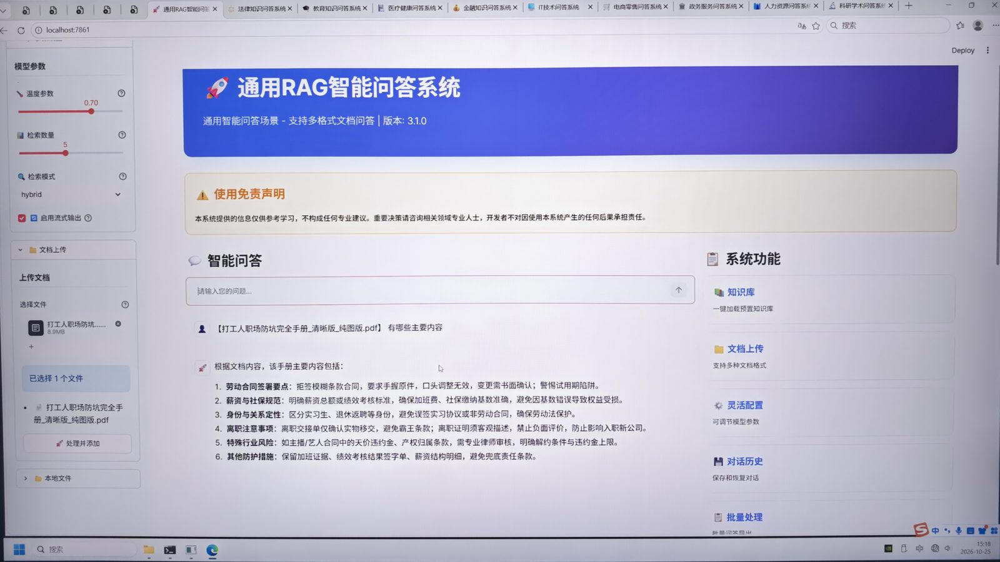

### PPO 训练智能体演示（500 万步训练成果，成功率 98%）

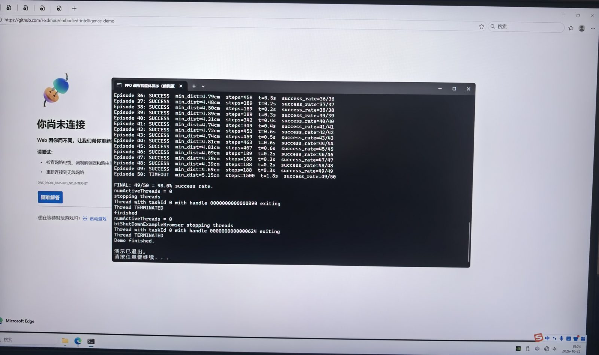

### 真机部署 · 断网全流程实证（菜单 [9]，9 张连拍）

新增【真机部署】入口，对齐工程化交付规范：

1. 点击运行后**先环境自检**（依赖/机器人配置/部署主流程/策略模型/安全参数 5 层防护）；
2. 提示符由甲方**自行输入真机 IP 或串口参数**（支持 TCP/UDP/CAN/EtherCAT/ROS/Modbus 六协议适配）；
3. 输入错误/缺省/不可达 → **优雅退出**，仅提示"真机环境未就绪，请检查硬件连接"，不抛任何 traceback；
4. 真机底层驱动包**不暴露于 U 盘根目录**，仅保留 `真机部署.bat` 单一调用接口；
5. 无真机时可输入 `SIM` 走**仿真部署排练**：标定 → 部署循环（周期/振动/冲击扰动注入）→ 部署健康检查 → 部署报告与归档，全程断网。

![菜单[9]真机部署+环境自检全绿+连接参数提示](docs/screenshots/06_deploy_menu_selfcheck_prompt.jpg)

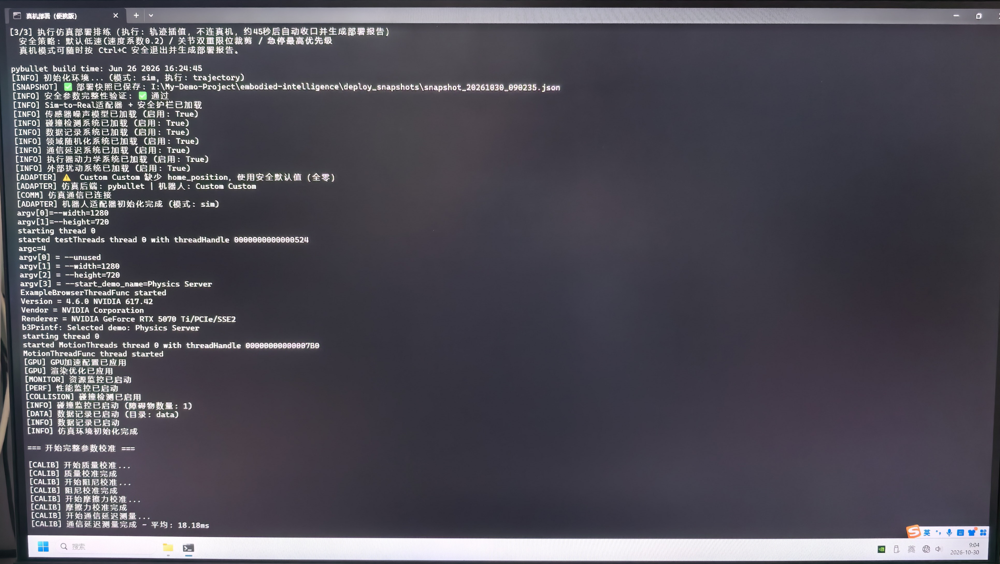

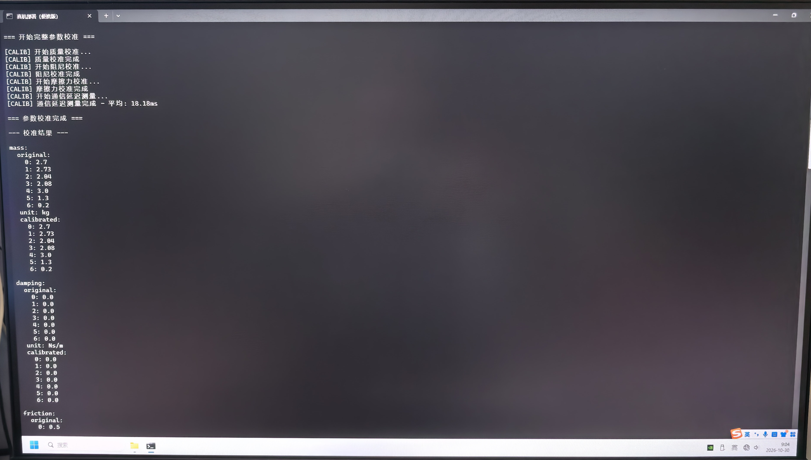

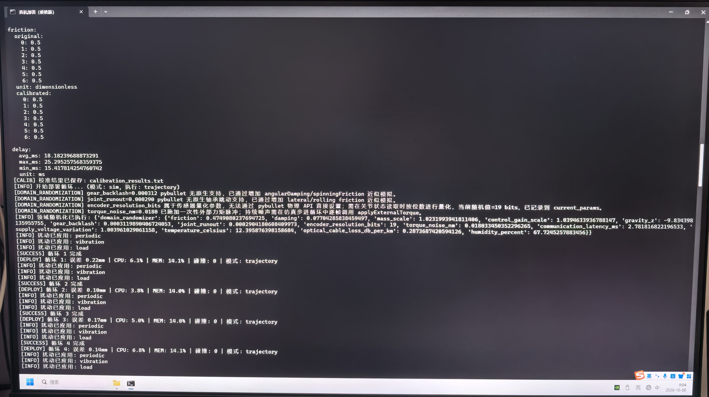

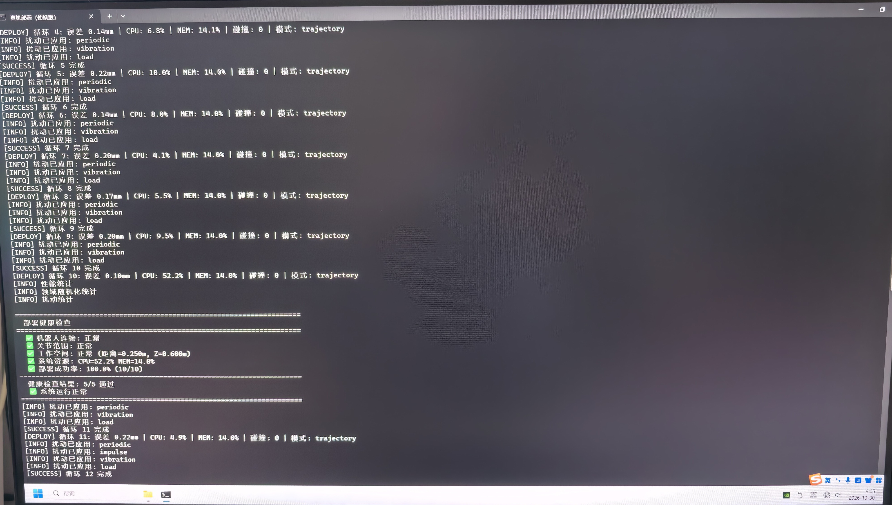

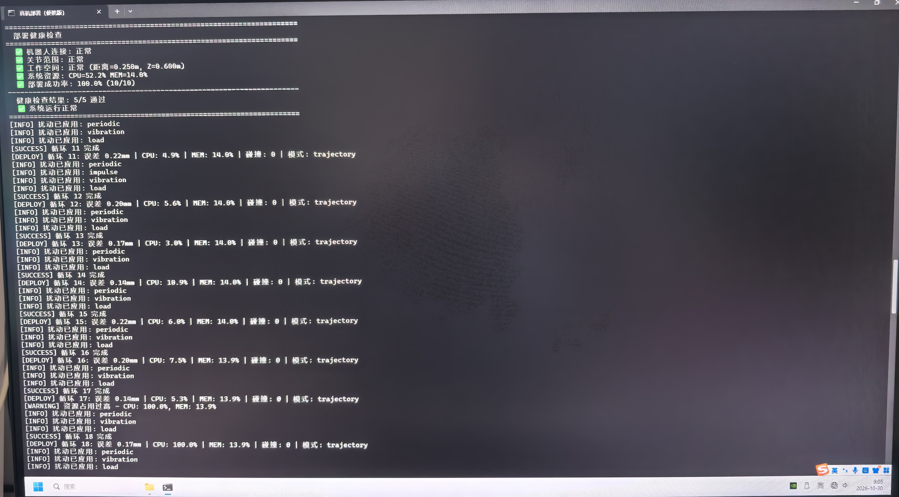

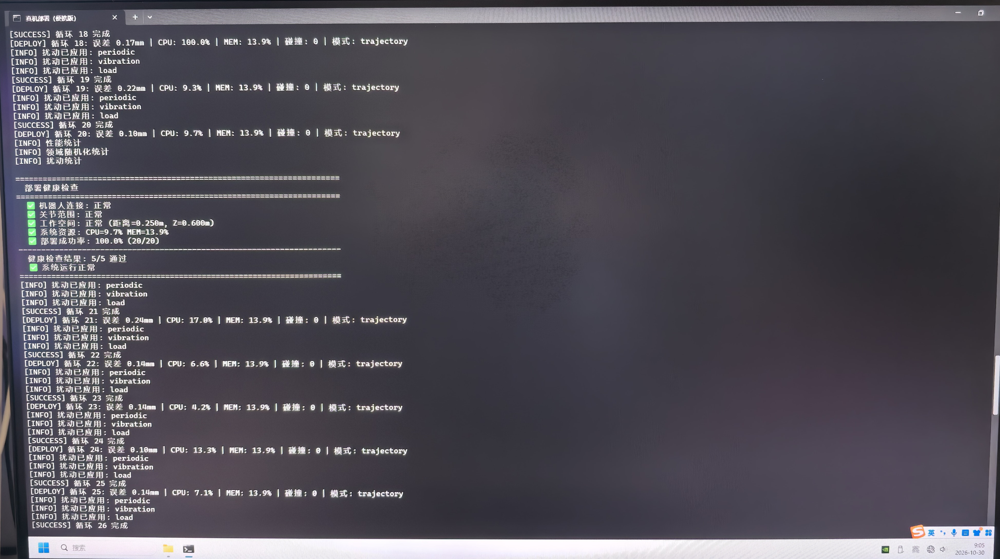

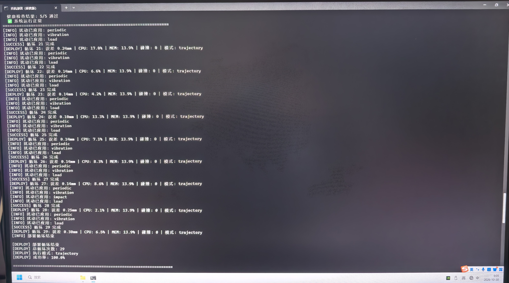

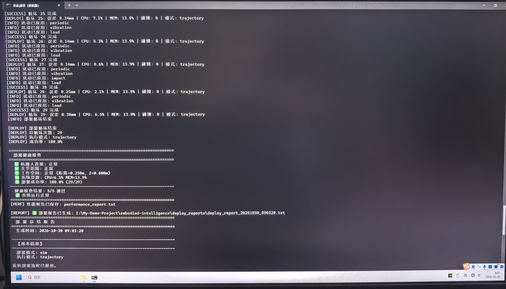

---

## 二、启动菜单截图

### 一键启动菜单（10 套系统，端口 7861-7877）

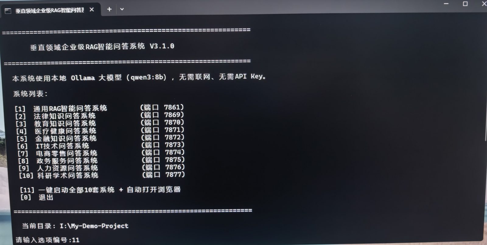

### 一键启动全部 10 套系统（本地 Ollama 自动就绪）

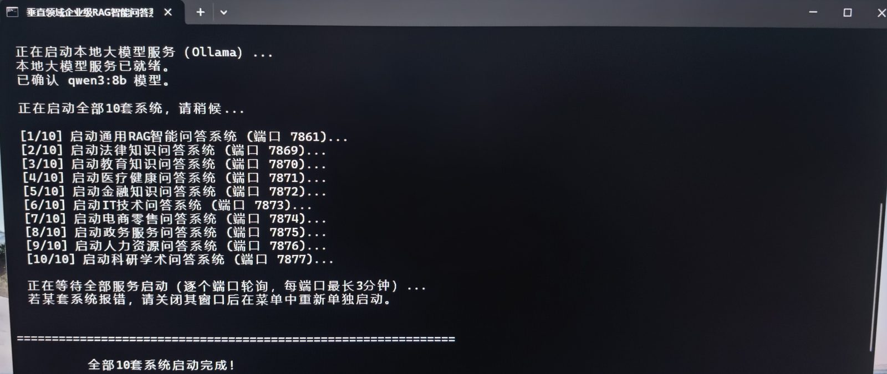

### 全部启动完成（浏览器按端口就绪顺序自动打开）

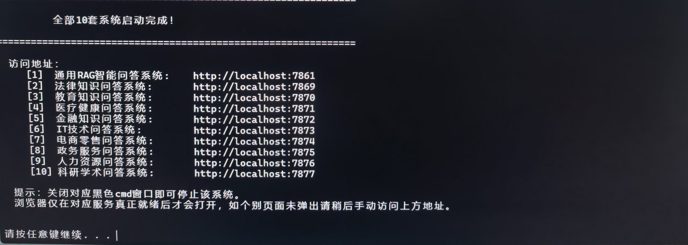

---

## 三、目录结构

```text
My-Demo-Project/
├── 一键启动RAG系统.bat            # 主入口：菜单式启动10套RAG系统（端口7861-7877）
├── Demo启动菜单.bat               # 具身智能演示总菜单（机械臂/仿真/PPO/自检/真机部署等9项）
├── 真机部署.bat                   # 真机部署单一调用接口（自检→参数→部署/优雅退出）
├── 合并模型到本机.bat             # 首次使用前：合并分卷Ollama模型到U盘
├── 断网演示自检.bat               # 演示前离线环境自检
├── 关闭所有系统.bat               # 一键停止全部Streamlit服务
├── start_demo.bat / start_robot.bat       # 机械臂智能控制演示
├── 启动PyBullet仿真.bat / 启动训练好的智能体.bat   # 仿真与PPO智能体演示
├── README.md
├── app/                                   # 10套RAG问答系统主体
│   ├── run.py                             # 通用RAG智能问答（端口7861）
│   ├── rag.py                             # 全格式通用加载层（纯图OCR/录音转写/视频抽帧/优雅兜底）
│   ├── legal_qa.py  education_qa.py  medical_qa.py  finance_qa.py
│   ├── tech_qa.py  e_commerce_qa.py  government_qa.py  hr_qa.py  academic_qa.py
│   ├── config/settings.py                 # 108种格式上传白名单与十套系统配置
│   ├── ocr_bridge.ps1                     # Windows内置中文OCR桥接（完全离线）
│   ├── audio_asr.ps1                      # Windows内置语音识别桥接（录音转写离线）
│   ├── video_frames.ps1                   # 视频抽帧桥接（30/60帧、4K/8K全支持）
│   ├── office_doc_extract.ps1             # 老式.doc Word COM提取+导出PDF桥接
│   ├── office_xls_extract.ps1             # 老式.xls Excel COM提取+导出PDF桥接
│   ├── *_faiss_index/                     # 10套预置768维FAISS向量索引
│   └── legal_knowledge_base/              # 法律法规示例语料（14部PDF）
├── embodied-intelligence/                 # 具身智能：机械臂控制/PPO训练/仿真/部署脚本
│   └── real_deploy_entry.py               # 真机部署调用接口实现（驱动包内置不暴露）
├── _PUBLIC_NTA_OUTPUT/
│   └── EmbodiedSim-Framework/             # 三层编排+AI决策+数字孪生综合演示框架
├── docs/screenshots/                      # 实测截图（本README引用）
├── python/                                # 便携Python 3.12.8（随U盘交付，不入仓库）
├── ollama/                                # 本地Ollama服务+qwen3:8b模型（随U盘交付，不入仓库）
└── hf_cache/                              # 嵌入模型离线缓存390MB（随U盘交付，不入仓库）
```

---

## 四、快速开始（任意电脑 · 完全断网可用）

1. **拷贝**：将整个 U 盘目录复制到目标电脑（建议内存 ≥ 16GB）。
2. **合并模型**（仅首次）：双击 `合并模型到本机.bat`，将分卷大模型合并到 U 盘。
3. **启动**：双击 `一键启动RAG系统.bat`：
   - 输入 `1`-`10` 启动单套系统；输入 `11` 一键启动全部 10 套并自动打开浏览器；
   - 浏览器仅在对应端口真正就绪后打开（U 盘首次加载较慢，每端口最长等待 3 分钟）。
4. **使用**：左侧「文档上传」支持一次选择多个文件（108 种格式），点击「处理并添加」后直接问答；也可加载预置知识库。
5. **具身智能演示**：双击 `Demo启动菜单.bat`，可选机械臂控制、PyBullet 仿真、PPO 智能体、数字孪生、真机部署等 9 项演示。

| 系统 | 端口 | 系统 | 端口 |
|---|---|---|---|
| 通用RAG智能问答 | 7861 | IT技术问答 | 7873 |
| 法律知识问答 | 7869 | 电商零售问答 | 7874 |
| 教育知识问答 | 7870 | 政务服务问答 | 7875 |
| 医疗健康问答 | 7871 | 人力资源问答 | 7876 |
| 金融知识问答 | 7872 | 科研学术问答 | 7877 |

---

## 五、全格式支持（108 种，断网离线全打通）

| 类别 | 格式 | 处理通道 |
|---|---|---|
| 文档 | pdf docx doc xlsx xls pptx ppt rtf msg epub html htm xhtml | 文字层提取；**纯图版自动渲染/导出PDF + Windows内置OCR** |
| 图片 | png jpg jpeg bmp tif tiff gif webp ico | Windows 内置中文 OCR（GIF/WebP/ICO 自动转 PNG） |
| 音频 | mp3 m4a wav amr wma aac flac ogg silk aw | Windows 内置语音识别离线转写（含所有录音对话内容） |
| 视频 | mp4 mov avi mkv flv wmv m4v webm 3gp | 内置抽帧（30/60 帧、4K/8K 全支持）+ 逐帧 OCR |
| 压缩包 | zip | 成员递归加载 |
| 文本/代码/配置 | txt md py csv tsv log json jsonl xml yaml yml ini cfg conf toml bat ps1 sh js css sql rst tex java c cpp h ts tsx go rb php ipynb svg vue proto 等 50+ 种 | 多编码解码（utf-8/gbk/big5），含无扩展名文件 |

**可靠性设计**：任何损坏/无内容文件均返回优雅标记文档，批量处理永不因单文件中断；所有桥接脚本仅依赖 Windows 内置组件（OCR / 语音识别 / Office COM），零第三方服务、零联网。

---

## 六、技术栈

- **大模型**：本地 Ollama `qwen3:8b`（OpenAI 兼容接口，U 盘内自包含）
- **嵌入模型**：`shibing624/text2vec-base-chinese`（768 维，与 10 套预置 FAISS 索引维度一致，HF 离线缓存）
- **应用层**：Python 3.12.8 便携版 + Streamlit + LangChain + FAISS
- **离线能力**：Windows.Media.Ocr 中文 OCR、System.Speech 语音识别、Media 帧提取、Word/Excel COM 桥接

---

## 七、免责声明

本仓库全部系统仅供技术研究与学习交流使用。法律 / 医疗 / 金融系统的回答仅供参考，不构成任何专业意见；重要决策请咨询执业专业人士。使用者须自行评估风险，因使用本仓库内容导致的任何损失由使用者承担。
