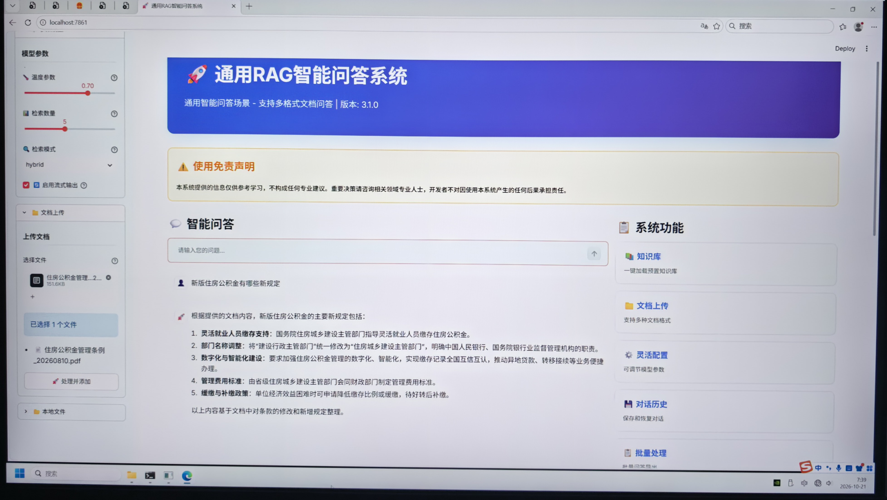
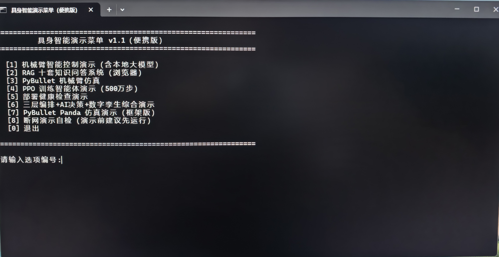

# 垂直领域企业级RAG智能问答系统 V3.1.0

RAG十套系统 · 本地 Ollama 大模型 · 完全离线可运行 · 脱敏开源骨架

本仓库为【垂直领域企业级RAG智能问答系统 V3.1.0】的**脱敏源码骨架**：包含十套系统入口脚本、RAG 核心逻辑（app/rag.py）、工程支撑模块、具身智能演示工程与 EmbodiedSim-Framework 仿真框架。模型权重、嵌入缓存、FAISS 向量索引、知识库文档、运行日志均**不入库**（见 `.gitignore`）。

## 完全离线运行实证（核心证据）

下图为系统在**完全断网**环境下的实机运行截图：浏览器地址栏 `localhost:7861`，知识库文档、大模型、嵌入模型、向量索引全部位于本地便携存储，问答与检索全程零联网、零云端依赖。



证据要点：

- **网络状态**：完全断网，全程无任何外网连接
- **大模型**：本地 Ollama qwen3:8b（便携版，无需API Key）
- **嵌入模型**：shibing624/text2vec-base-chinese，本地离线缓存（`HF_HUB_OFFLINE=1` 强制离线）
- **向量索引**：FAISS 预置索引，断网状态下加载并检索成功
- **问答效果**：加载《住房公积金管理条例》知识库后离线完成结构化问答，回答附检索出处

## 系统列表与端口对应

十套系统共用核心模块 `app/rag.py`，仅知识库与提示词模板不同。

| 编号 | 系统名称 | 端口 | 入口文件 |
| --- | --- | --- | --- |
| [1] | 通用RAG智能问答系统 | 7861 | `app/run.py` |
| [2] | 法律知识问答系统 | 7869 | `app/legal_qa.py` |
| [3] | 教育知识问答系统 | 7870 | `app/education_qa.py` |
| [4] | 医疗健康问答系统 | 7871 | `app/medical_qa.py` |
| [5] | 金融知识问答系统 | 7872 | `app/finance_qa.py` |
| [6] | IT技术问答系统 | 7873 | `app/tech_qa.py` |
| [7] | 电商零售问答系统 | 7874 | `app/e_commerce_qa.py` |
| [8] | 政务服务问答系统 | 7875 | `app/government_qa.py` |
| [9] | 人力资源问答系统 | 7876 | `app/hr_qa.py` |
| [10] | 科研学术问答系统 | 7877 | `app/academic_qa.py` |

## 快速开始

### 1. 环境要求

- Python 3.10 及以上
- Ollama 本地服务与 `qwen3:8b` 模型
- 嵌入模型 `shibing624/text2vec-base-chinese`（可提前离线缓存）

### 2. 安装依赖

```bash
pip install streamlit langchain langchain-community langchain-openai langchain-text-splitters langchain-huggingface sentence-transformers faiss-cpu python-dotenv pypdf docx2txt openpyxl
```

参考版本组合（便携版实测）：sentence-transformers 6.0.1、langchain-huggingface 1.2.2、huggingface-hub 1.29.0、transformers 5.16.1。

### 3. 准备模型

```bash
# 大模型：本地 Ollama
ollama pull qwen3:8b
```

嵌入模型在联网环境下载一次后，将整个 `hf_cache` 目录（含 `hub` 子目录）随项目迁移，断网场景按下文环境变量表指向该目录即可。

### 4. 配置 .env（离线演示走 Ollama 分支，无需任何 Key）

```ini
LLM_BACKEND=ollama
OLLAMA_BASE_URL=http://127.0.0.1:11434/v1
OLLAMA_MODEL_NAME=qwen3:8b
```

如需云端模型分支（联网场景），配置 `DASHSCOPE_API_KEY` 或 `OPENAI_API_KEY`；仓库内所有 Key 均为脱敏占位。

### 5. 启动

```bash
# 命令行启动，端口可替换为上表任一端口
streamlit run app/run.py --server.port 7861
```

Windows 下也可双击 `一键启动RAG系统.bat`（数字菜单 1-10 对应十套系统）或 `Demo启动菜单.bat`（具身智能演示菜单）。

### 6. 日常操作流程

1. 点击【加载预置索引】。
2. 点击【保存当前索引】。
3. 点击【上传文档（选择文件）】里的【上传】，选择好文件后下方显示"已选择N个文件"。
4. 点击【处理并添加】，下方显示"成功添加N个文档"。
5. 在【智能问答】输入框进行提问。

## 文档支持

支持 PDF、Word、Excel、Markdown、TXT、HTML 六类文档解析；单文件上限50MB，单次最多上传10个文件；回答附检索出处。

## 具身智能演示菜单（便携版）

下图为双击 `Demo启动菜单.bat` 后弹出命令提示符显示的数字菜单（具身智能演示菜单 v1.1 便携版），输入对应阿拉伯数字即可运行对应演示。



- [1] 机械臂智能控制演示（含本地大模型）
- [2] RAG 十套知识问答系统（浏览器）
- [3] PyBullet 机械臂仿真
- [4] PPO 训练智能体演示（500万步）
- [5] 部署健康检查演示
- [6] 三层编排+AI决策+数字孪生综合演示
- [7] PyBullet Panda 仿真演示（框架版）
- [8] 断网演示自检（演示前建议先运行）
- [0] 退出

## 目录结构（脱敏骨架）

```text
├── 一键启动RAG系统.bat         # [主入口] 数字菜单，启动十套RAG问答系统
├── 关闭所有系统.bat            # 一键关闭已启动的问答系统
├── 合并模型到本机.bat          # 首次使用：合并 Ollama 本地大模型（qwen3:8b）
├── 断网演示自检.bat            # 演示前断网自检
├── Demo启动菜单.bat            # 具身智能演示数字菜单
├── start_demo.bat             # 机械臂演示备用启动脚本
├── start_robot.bat            # 机械臂演示启动脚本
├── 启动PyBullet仿真.bat        # PyBullet 机械臂仿真
├── 启动训练好的智能体.bat       # PPO 训练智能体演示
├── rag.py                     # RAG 核心逻辑代码（根目录入口）
├── app/                       # 十套问答系统核心目录
│   ├── run.py … academic_qa.py # 十套系统入口（见端口表）
│   ├── rag.py                 # RAG 核心模块（解析、分块、向量化、检索、生成）
│   ├── batch_processor.py     # 文档批处理模块
│   ├── chat_history.py        # 对话历史模块
│   ├── document_visualizer.py # 文档可视化模块
│   ├── export_utils.py        # 导出工具模块
│   ├── logger.py              # 日志模块
│   └── config/                # 配置目录（脱敏版，Key 经 .env 提供）
├── embodied-intelligence/     # 具身智能演示工程（PPO 机械臂训练与推理、PyBullet 仿真、sim2real）
├── _PUBLIC_NTA_OUTPUT/        # 内含 EmbodiedSim-Framework 仿真框架
├── docs/                      # 架构与设计文档
├── demo_screenshot.jpg        # 完全离线运行实机截图（核心证据，断网实测）
├── launch_menu.jpg            # 具身智能演示数字菜单界面截图（便携版）
└── README.md                  # 项目说明文档
```

## 架构文档

系统分层、问答数据流、索引构建流程与离线便携设计见 [docs/ARCHITECTURE.md](docs/ARCHITECTURE.md)。

## 脱敏与安全声明

- 所有硬编码 API Key 已替换为脱敏占位，真实 Key 通过环境变量或仓库根目录 `.env` 提供（`.env` 被 `.gitignore` 排除）。
- 模型权重（`ollama/`、`*.safetensors`、`*.bin` 等）、嵌入缓存（`hf_cache/`）、向量索引（`*_faiss_index/`、`*.faiss`、`*.pkl`）、知识库文档、日志与导出文件均被 `.gitignore` 排除，不入库。
- 仓库不含任何真实用户路径与商业客户数据。

## 免责声明

本项目仅供技术研究与学习交流使用，不得用于任何非法用途；系统提供的信息仅供参考，不构成任何专业建议。
