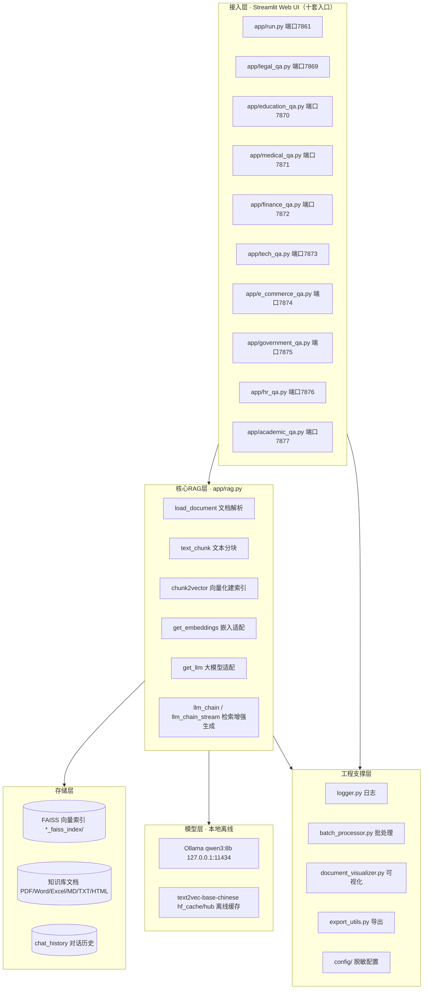
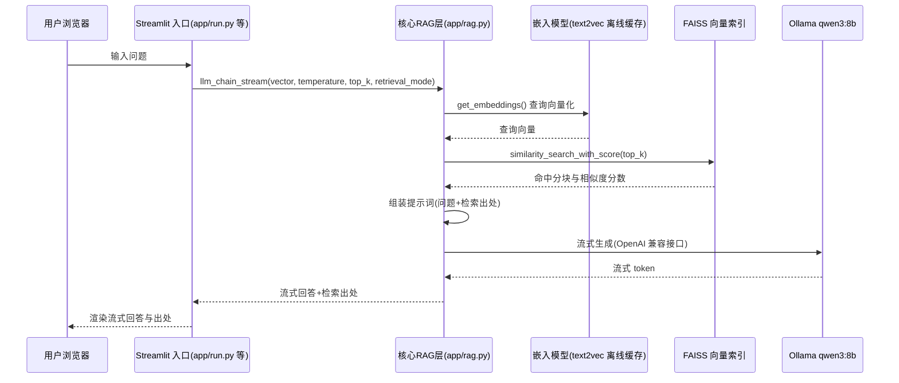
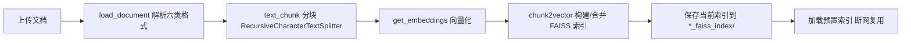

# 系统架构文档（V3.1.0 脱敏开源骨架）

> 对应仓库代码：垂直领域企业级RAG智能问答系统（十套）+ 具身智能演示工程 + EmbodiedSim-Framework 仿真框架。

## 1. 总体分层架构

## 2. 分层职责

| 层 | 职责 | 关键代码 |
| --- | --- | --- |
| 接入层 | 十套垂直领域系统的 Streamlit 界面：参数控制台（Temperature / Top-K / 检索模式 / 流式输出）、文档上传、智能问答、功能导航 | `app/run.py` 等十个入口 |
| 核心RAG层 | 文档解析、文本分块、向量化、索引构建、检索、提示词组装、流式生成 | `app/rag.py` |
| 存储层 | FAISS 索引持久化、知识库文档、对话历史 | `app/*_faiss_index/`、`chat_history.py` |
| 模型层 | 本地大模型与嵌入模型，全离线运行 | Ollama qwen3:8b、text2vec-base-chinese |
| 工程支撑层 | 日志、批处理、文档可视化、导出、脱敏配置 | `logger.py`、`batch_processor.py`、`document_visualizer.py`、`export_utils.py`、`config/` |

## 3. 问答数据流（时序）

检索模式支持向量检索与 Hybrid（混合）检索；`query_expansion` 可对问题做扩展改写以提升召回。

## 4. 索引构建流程

## 5. 离线便携架构（断网演示关键设计）

所有路径在运行时按脚本所在位置相对推导，不依赖盘符、不依赖 C 盘任何缓存与环境变量：

| 配置项 | 便携版取值 | 设置位置 | 作用 |
| --- | --- | --- | --- |
| `OLLAMA_MODELS` | <便携介质>/ollama/models | 启动 bat | 大模型权重随便携介质携带 |
| `HF_HOME` | <便携介质>/hf_cache | 启动 bat / `app/rag.py` | HuggingFace 缓存根目录 |
| `SENTENCE_TRANSFORMERS_HOME` | <便携介质>/hf_cache/hub | `app/rag.py` | sentence-transformers 将该变量直接作为 cache_dir，必须指到 hub 层才能命中 `models--shibing624--text2vec-base-chinese` |
| `HF_ENDPOINT` | https://hf-mirror.com | `app/rag.py` | 国内镜像（联网场景兜底） |
| `HF_HUB_OFFLINE` / `TRANSFORMERS_OFFLINE` | 1 | `app/rag.py` | 强制离线，杜绝联网检查与超时 |
| `LLM_BACKEND` | ollama | `.env` / 环境变量 | 切到本地 Ollama 分支，大模型与嵌入全本地、零 Key |
| `OLLAMA_BASE_URL` | http://127.0.0.1:11434/v1 | `.env` / 环境变量 | Ollama 本地服务的 OpenAI 兼容接口 |

设计要点：

- **双分支模型适配**：`get_llm` / `get_embeddings` 优先 `LLM_BACKEND=ollama` 本地分支（零 Key）；云端分支（DashScope / OpenAI）自动过滤无效占位 Key，并逐级回落到本地 text2vec。
- **`.env` 覆盖**：`load_dotenv(override=True)`，项目配置优先于系统环境变量。
- **流式与超时加固**：ChatOpenAI `streaming=True` 降低首字延迟；本地分支 `timeout=180 / max_retries=1`，断网场景不挂起。
- **自检脚本**：`断网演示自检.bat` 在演示前逐项检查模型 blob、嵌入缓存、向量索引是否齐备。

## 6. 配置脱敏设计

- `app/config/__init__.py` 中所有 Key（`AMAP_WEB_KEY`、`AMAP_JS_KEY`、`AMAP_JS_SECURITY_CODE`、`DASHSCOPE_API_KEY` 1-4）均从环境变量或根目录 `.env` 读取，仓库内默认值为空字符串。
- `.gitignore` 排除 `.env` 与 `.env.*`，真实 Key 永不入库。

## 7. 具身智能子系统

### 7.1 embodied-intelligence（机械臂训练与 sim2real）

按文件名前缀的模块分组：

- **训练线**：`train_*.py`、`finetune_ppo.py`、`finetune_env.py`、`rl_algorithm_comparison.py`——PPO 机械臂 reach 训练、课程学习、参数扫描
- **仿真线**：`pybullet_simulation.py`、`robot_sim.py`、`sim_backends.py`、`simulation_enhanced.py`、`robot_gui.py`、`robot_gui_kuka.py`——PyBullet 物理仿真与 GUI
- **部署线**：`deploy_*.py`、`sim2real_transfer.py`、`real_robot_adapter.py`、`validate_model_for_deploy.py`、`deployment_readiness_check.py`、`real_robot_ready_system.py`——sim2real 迁移与部署健康检查
- **规划与控制**：`trajectory_planning.py`、`rrt_*.py`、`gripper_control.py`、`joint_control_schemes.py`、`ik_validation.py`
- **工程支撑**：`logger_*.py`、`config_*.py`、`settings.py`、`robots_config.py`、`performance_monitor.py`、`realtime_monitor.py`
- **应用集成**：`digital_twin_system.py`、`llm_decision_sdk.py`、`autonomous_decision_system.py`、`robot_mcp_server.py`、`api_server.py`、`ollama_client.py`（桥接本地大模型）
- **演示入口**：`demo_trained_agent.py`（500万步训练智能体推理）、`demo_robot_gui.py`、`eval_headless.py`（无头评估）

### 7.2 EmbodiedSim-Framework（_PUBLIC_NTA_OUTPUT/）

- `core/`：仿真核心
- `engineering/`：工程支撑
- `deployment/`：部署编排
- `applications/`：应用层（`digital_twin_system.py`、`llm_decision_sdk.py` 等）
- `examples/`、`docs/`：示例与文档

### 7.3 演示编排

`Demo启动菜单.bat` 数字菜单串联：机械臂智能控制、RAG 十套、PyBullet 仿真、PPO 训练智能体、部署健康检查、三层编排+AI决策+数字孪生综合演示、断网自检。

## 8. 工程支撑层（RAG）

- `logger.py`：统一日志
- `batch_processor.py`：文档批处理
- `document_visualizer.py`：文档可视化
- `export_utils.py`：问答结果导出
- `chat_history.py`：对话历史保存与回溯
